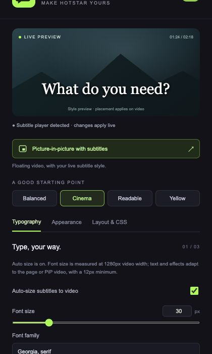
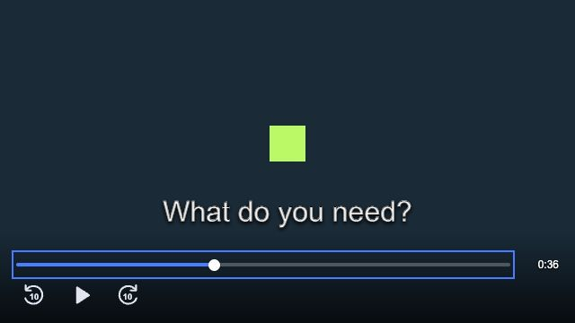
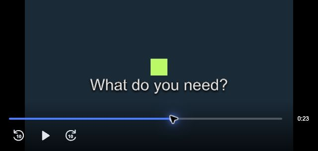

<p align="center"></p>

# Hotstar Subtitle Studio

Customize Hotstar subtitles and bring them into a floating picture-in-picture window. Adjust fonts, colors, spacing, backgrounds and placement, with a live preview and styles saved on your device.

A Chrome Manifest V3 extension. No build step, account, API keys, backend or runtime dependencies.

**Version 1.0.0** · [MIT license](LICENSE) · Desktop Chrome

<p align="center"></p>

## Features

| Control | Options |
| --- | --- |
| Typography | Fixed or automatic font size, installed font families, weight, italics, text color and opacity |
| Spacing | Letter spacing, word spacing and line height |
| Appearance | Background color and opacity, padding, rounded corners, text outline and shadow |
| Placement | Horizontal and vertical offsets, maximum width and text alignment |
| Advanced CSS | Custom subtitle declarations, such as `text-transform: uppercase;` |
| Presets and backups | Four presets, JSON export/import, reset and an enable switch |
| Playback overlay | Scrubbable seek bar, remaining time, play/pause and ±10-second controls over the page and PiP video |
| Picture-in-picture | Floating video and live captions, with no additional top or bottom toolbar |

## Install locally

1. Download this repository using **Code → Download ZIP** and extract it, or clone it:

   ```sh
   git clone https://github.com/SharatChandar/hotstar-subtitles-pip-customizer.git
   ```

2. Open `chrome://extensions` in desktop Chrome.
3. Enable **Developer mode** in the upper-right corner.
4. Click **Load unpacked** and select the extracted/cloned folder containing `manifest.json`.
5. Refresh any already-open Hotstar tabs.
6. Play a video on [Hotstar](https://www.hotstar.com), turn on subtitles in the player, and open **Subtitle Studio** from Chrome's extensions menu. Pin it for easy access.

Styles apply live and save automatically across Hotstar tabs and browser restarts on the same Chrome profile. To update an unpacked installation, download/pull the latest files, reload the extension on `chrome://extensions`, then refresh Hotstar.

## Customize subtitles

Choose a preset or adjust the **Typography**, **Appearance**, and **Layout & CSS** tabs. The enable switch restores Hotstar's own styling when switched off. **Reset all** restores the extension defaults.

- Fonts must be installed on your device. Font stacks such as `Verdana, sans-serif` are supported.
- Positive vertical offsets move subtitles **up**; negative values move them down. Positive horizontal offsets move them right.
- Font sizes and offsets use pixels in fixed-size mode. Large values can move captions outside the video, especially in a small PiP window.
- The preview shows text styling. Placement and wrapping depend on the actual video dimensions.
- Selecting a preset replaces the current style, including custom CSS; the enable, auto-size and playback-overlay switches keep their settings.
- **Back up & restore** exports/imports a versioned JSON style file. Backups contain your settings, including any custom CSS you entered.

### Custom CSS

Enter declarations without selectors or braces:

```css
text-transform: uppercase;
font-variant: small-caps;
```

Custom declarations apply to caption cues and spans and override the regular controls. URLs, imports, expressions and rule blocks are rejected. Browser-invalid declarations are ignored.

### Automatic subtitle sizing

Enable **Auto-size subtitles to video** in **Typography**. The font-size control becomes your reference size at a 1280px-wide video: a 32px setting renders at 16px on a 640px-wide video and 48px at 1920px. A 12px minimum and 120px maximum keep text within readable bounds.

Sizing follows the fitted video area, accounting for window height and letterboxing. It updates when the normal player, fullscreen video or PiP window resizes. Pixel-based spacing, outlines, shadows, padding and offsets scale with the font; line-height ratios and maximum-width percentages keep their meaning. Custom CSS with explicit sizes can override this behavior. Turn auto size off to return to fixed pixel sizing.

### Playback overlay

Move the pointer over the video to reveal a blue seek bar, white scrubber thumb, remaining time, and rewind-10, play/pause and forward-10 icons along the bottom. Click or drag the seek bar to jump through the video; keyboard arrows also adjust the focused slider. The bar tracks the available seekable timeline and is disabled for non-seekable streams.

The controls are drawn over the video, without reserving a separate toolbar outside it. Subtitles lift above the controls while visible. The overlay hides when the pointer leaves the video or its window loses focus, including while paused or a control is focused. While the pointer is inside, it fades after inactivity during playback and stays visible when paused or keyboard-focused. Seeking clamps to the available timeline, including live/seekable ranges. Streams without seeking support display a short message when a seek button is pressed.

The same overlay works on Hotstar and in PiP. Disable it using **Playback overlay controls** in **Layout & CSS**. This switch is independent of the custom-subtitle enable switch.



## Picture-in-picture with subtitles

While a Hotstar video is loaded, click **Picture-in-picture with subtitles** in the popup. The extension uses Chrome's [Document Picture-in-Picture API](https://developer.chrome.com/docs/web-platform/document-picture-in-picture) to place the original video element and a live copy of its captions in an always-on-top window. Your subtitle style also applies there.



Only the video, captions and fading playback overlay occupy the PiP content area; no custom top or bottom bar is added. Chrome retains its native window title/close/return controls. Use the overlay to play/pause or seek by ten seconds. Close the window, use Chrome's native return control, or click the extension's PiP button again to restore the video to Hotstar. Keep the original tab open, and select audio/subtitle tracks there before opening PiP.

**Compatibility:** subtitle PiP requires desktop Chrome with Document PiP support (Chrome 116+). It has been tested with synthetic video in Chrome, including caption/style updates, cue-container replacement, playback controls, closing and reopening. **Protected Hotstar playback has not yet been verified end to end.** Player or DRM behavior may prevent playback after moving the video element; return to the tab if that happens. The extension does not capture or re-encode video.

## Privacy and permissions

The extension has no analytics, telemetry, external scripts, remote fonts or backend. It does not request credentials or API keys. Settings stay in `chrome.storage.local`; they are not synced to an external service. The extension accesses the current video and caption DOM to provide styling and PiP.

| Permission / access | Purpose |
| --- | --- |
| `storage` | Save and restore subtitle settings on this device |
| `activeTab` | Temporarily access the active tab when you invoke the extension |
| `scripting` | Start PiP in the active Hotstar page in response to your click |
| Content scripts on HTTPS Hotstar domains | Apply styles and respond to settings changes on Hotstar pages |

See [PRIVACY.md](PRIVACY.md) for details.

## Known limitations and troubleshooting

- **Nothing changes:** refresh Hotstar after installing/reloading the extension and turn on the player's subtitle track.
- **No captions in the video:** this extension styles existing captions; it does not generate or enable them.
- **PiP is unavailable:** use a supported desktop Chrome version and invoke PiP from the extension while a Hotstar video is loaded.
- **Captions are clipped:** reduce font size, padding or placement offsets; clear custom CSS or reset the style.
- Burned-in subtitles cannot be styled. Native video PiP does not carry Hotstar's HTML captions; use this extension's document PiP button.
- Styling targets `#video-container .shaka-text-container`. A Hotstar player redesign may require a selector update.
- PiP closes if the original player is removed or replaced. Fullscreen styling requires the subtitle container to remain inside the fullscreen player.

## Development and verification

No install/build step is required for the extension. Node.js is used only for development checks; Python serves local browser fixtures.

```sh
node scripts/check.mjs
python3 -m http.server 8765 --bind 127.0.0.1
```

Open these URLs in desktop Chrome:

| Fixture | What it verifies |
| --- | --- |
| [Subtitle integration](http://127.0.0.1:8765/tests/fixture.html) | 41 checks covering styles, new/replaced cues, responsive sizing, letterboxing, overlay visibility, playback, seeking, timeline updates, custom CSS and restoration; each should report `pass: true` |
| [Popup preview](http://127.0.0.1:8765/tests/popup.html) | Real popup UI with mocked extension APIs; settings reset on reload |
| [PiP fixture](http://127.0.0.1:8765/tests/pip.html) | Real Document PiP with synthetic media; manually test caption changes, style changes, cue replacement, controls, close and reopen |

The fixtures do not reproduce Chrome extension permissions or Hotstar's protected playback. See [CONTRIBUTING.md](CONTRIBUTING.md) for the manual extension checklist.

To exercise the slider with real seekable synthetic media, optionally generate a local test clip using FFmpeg, then open `/tests/pip.html?finite=1`:

```sh
mkdir -p tests/generated
ffmpeg -f lavfi -i 'color=c=0x152d36:s=640x360:r=10:d=60' -vf 'drawbox=x=300:y=140:w=40:h=40:color=0xc4f17a:t=fill' -c:v libx264 -pix_fmt yuv420p -movflags +faststart -an tests/generated/seek-test.mp4
```

Generated test media is ignored by Git. FFmpeg is only needed for this optional development check.

### Project layout

```text
manifest.json          Chrome extension configuration
shared.js              Settings, presets and scoped CSS generation
content.js             Hotstar styles, storage updates and status messages
controls.js            Shared playback overlay and bounded seeking
pip.js                 Document PiP lifecycle and live caption mirroring
popup.html/css/js      Settings interface
icons/                 SVG logo and Chrome PNG icons
scripts/               Local checks and icon generation
tests/                 Browser fixtures and mocked extension APIs
docs/images/           Screenshots using preview/synthetic content
```

To regenerate PNG icons, install Pillow in your development environment and run `python3 scripts/generate-icons.py`. Pillow is not needed to load or use the extension.

## License

[MIT](LICENSE) © 2026 SharatChandar.

This is an independent project, not affiliated with or endorsed by Hotstar, JioHotstar or their owners. Those names and trademarks belong to their respective owners.
